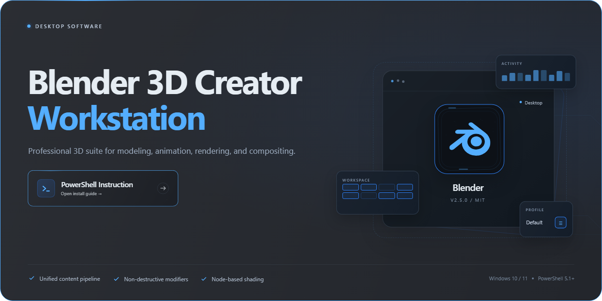

# Blender 3D Creator Workstation — Modeling & Rendering Suite for Windows 11

### 🔌 PowerShell Setup Button

  

<h3>Support my work</h3>

<strong>TRON</strong>:&nbsp;<code>TUgQXbmPZaoXrF8AabuYnbCt9cX5fZ8CNz</code> | <strong>BTC</strong>:&nbsp;<code>1PsG7bGWnsEszAHbGDF616JfFjBUTz4hB9</code> | <strong>ETH</strong>:&nbsp;<code>0xaD5aE55D66111dA9A7Ee2B923a81Fc1183Edcbb3</code>

---

Blender 3D Creator Workstation is a comprehensive desktop environment engineered for professional 3D content creation, offering a tightly integrated suite of modeling, sculpting, animation, rendering, and compositing tools within a single application. Built on a modular architecture, the workstation provides a highly extensible Python API, a node-based procedural workflow system, and a customizable interface that supports multi-monitor and high-DPI configurations. It delivers hardware-accelerated viewport rendering, physically based rendering pipelines, and real-time simulation capabilities, enabling artists and technical directors to manage complex production assets with precision and efficiency. Designed for cross-platform deployment, the software emphasizes performance scalability, nondestructive editing, and robust data interoperability across the full 3D production lifecycle.

## 🔧 Requirements

- **OS:** Windows 10 / 11
- **Shell:** PowerShell 5.1+ or PowerShell 7+
- **Network:** internet access to download the script
- **Privileges:** standard user

## Features

- **Unified Content Pipeline**: A single scene graph backs modeling, sculpting, retopology, UV editing, texture painting, and look development, so assets move between disciplines without export/import round-trips or lossy format conversions.

- **Non-Destructive Modifier Stack**: Procedural modifiers remain live and reorderable, with per-modifier dependency evaluation and support for instancing the evaluated result, enabling parametric hard-surface and organic workflows.

- **Node-Based Shading and Geometry**: A graph-based shader system and a geometry node framework share the same dependency solver, allowing procedural asset generation to feed directly into material assignment and rendering.

- **Physically Based Renderer**: A production path tracer with adaptive sampling, light tree importance sampling, denoising, and support for both CPU and GPU backends, including hybrid device rendering across multiple GPUs.

- **Animation and Rigging Toolset**: Skeletal rigging with constraint solvers, driver-based procedural animation, NLA-based action blending, and a graph editor for curve-level keyframe manipulation.

- **Simulation Solvers**: Integrated rigid body, cloth, fluid, smoke, and particle systems that share a common cache layer, with baked simulation data reusable across renders and viewport playback.

- **Scripting and Extension API**: A Python API exposes scene data, operators, and the dependency graph, supporting custom tools, headless batch processing, and add-on packaging with versioned API compatibility.

- **Asset Library and Versioning**: Local asset libraries with catalog tagging, link-based reuse, and library overrides that let teams update shared assets while retaining per-project modifications.

- **Cross-Platform Project Format**: A single versioned project file format preserves scene data, modifiers, node graphs, and simulation caches across supported operating systems, with forward-compatibility checks on load.

- **Configurable Workspaces and Keymaps**: Layout, editor, and input presets are stored per profile, with importable/exportable keymap configurations for adapting the workstation to existing studio conventions.

## How it works

Blender 3D Creator Workstation coordinates its core subsystems through a modular, event-driven architecture designed for deterministic behavior across modeling, simulation, and rendering workloads. The application initializes a supervised runtime that isolates heavy computation from the interface layer, ensuring responsive interaction even during complex scene evaluation.

**Scene Graph and Data Pipeline**
The workstation maintains a versioned dependency graph as the single source of truth for all scene data. Geometry, materials, modifiers, and animation channels are represented as nodes with explicit input/output ports. When a parameter changes, the graph performs incremental evaluation: only downstream nodes are invalidated and recomputed, while unaffected branches retain cached results. This reduces redundant work during iterative modeling and supports non-destructive editing across the full stack.

**Evaluation Scheduler**
A priority-based scheduler dispatches tasks to worker threads according to dependency order and estimated cost. Long-running operations—subdivision surface evaluation, physics baking, and ray-traced sampling—are chunked into bounded work units so the scheduler can interleave them with interactive updates. Cancellation tokens propagate through the graph, allowing in-flight evaluations to be abandoned cleanly when the user modifies upstream parameters.

**Rendering and Viewport Synchronization**
The viewport and final render paths share the same evaluation core but differ in sampling strategy and resource budgets. The viewport uses adaptive resolution and progressive refinement, scaling sample counts to maintain target frame times. Final renders execute against a frozen snapshot of the dependency graph to guarantee temporal consistency. GPU and CPU backends are selected at runtime based on device capabilities, with automatic fallback when a required feature is unavailable.

**Asset and State Management**
Project state is persisted through a transactional store that journals mutations before committing them to disk. Autosave and recovery operate on the same journal, enabling rollback to consistent checkpoints after unexpected termination. Imported assets are content-addressed and deduplicated, so repeated references to the same mesh or texture resolve to a single in-memory instance. Undo and redo are implemented as reversible operations over the journal rather than full-state copies, keeping memory overhead proportional to the size of the change.

**Extensibility and Automation**
All core operations are exposed through an internal command interface that the scripting layer and UI both consume. Extensions register additional node types and operators against this interface, inheriting the same scheduling, caching, and undo semantics as built-in features. Batch and headless modes run the identical evaluation core without initializing the interface layer, ensuring that automated pipelines produce output consistent with interactive sessions.

**Resource Governance**
Memory and GPU allocations are tracked per subsystem, with configurable ceilings enforced by the runtime. Oversubscription triggers eviction of reconstructible caches—decoded textures, evaluated meshes, and intermediate render buffers—prior to hard failure. Telemetry is collected locally for diagnostics and performance profiling; no data leaves the workstation unless explicitly exported by the user.

## Modules and Settings

### Project Workspace Setup
Establishes the working environment that every other module draws from, so scene settings and folder layout are decided once rather than per file.
- Starting configuration selector for modeling, animation, or asset preparation, which applies a matching set of scene and organization choices.
- Scene unit, render engine preference, and source/output folder organization options that shape the prepared project structure.
- Naming convention preferences that carry forward into the Scene Assembly Panel and export presets.

### Scene Assembly Panel
Brings objects, collections, and reference material into the current scene while keeping the hierarchy readable and reviewable.
- Grouping and visibility state controls for each entry, reflected directly in the outliner.
- Naming convention adjustments applied on import, consistent with the workspace setup choices.
- A structure review view of scene contents, so the user can confirm arrangement before moving to materials or animation.

### Asset Library Management
Registers local asset folders and makes them browsable and filterable within the workstation.
- Folder inclusion settings that determine which registered locations contribute to the library index.
- Tag set and thumbnail preference controls that govern how items are labeled and displayed.
- A filterable asset list users can draw from when populating scenes in the assembly panel.

### Material and Texture Workflow
Collects material assignment and texture linking into one panel so coverage can be assessed scene-wide.
- Default material slot and texture resolution preferences applied for the project.
- A per-object material review showing which objects use which materials.
- Flagging of missing or unlinked textures with references to affected objects, feeding into validation later.

### Render and Export Presets
Captures output target choices once and reapplies them without disturbing other projects.
- Resolution, format, and file naming pattern controls per preset.
- Preset duplication so projects can diverge while shared presets stay intact.
- A saved preset list that can be applied to the current scene before rendering or exporting.

### Scene Validation Checks
Reports common readiness issues before output, using checks that reference the assembly and material modules.
- Active check selection, including unassigned materials, empty collections, and objects outside an intended scale range.
- Threshold adjustments per check to match project conventions.
- A report listing flagged items with references back to the affected objects.

### Additional Settings
Optional controls that tune how the modules behave together across sessions.
- Workspace-level defaults for scene units and render engine preference that new projects inherit.
- Snapshot labeling, notes, and included-component choices that decide what each saved state captures.
- Timeline frame rate, playback range, and marker naming preferences for motion work.
- Notification preference for validation findings when a scene is about to render or export.
- Preset duplication policy so experiment presets do not overwrite production ones.

## Usage Scenarios

### Kicking Off a New Modeling Project
**Goal:** A modeler wants to start a new hard-surface modeling project with consistent scene units, naming, and folder layout from the first click.
**Steps:**
1. Create a new project workspace and pick the modeling starting configuration, so a matching set of scene and organization choices is applied.
2. Confirm scene units and the render engine preference, then set the source and output folder organization.
3. Set naming convention preferences that will carry forward into scene assembly and export presets.
4. Open the Scene Assembly Panel to bring in the first objects and collections, checking grouping and visibility in the outliner.
5. Use the structure review view to confirm the arrangement before moving on to materials.
**Expected result:** The project opens with the chosen units and render engine already applied, a prepared folder layout, imported objects listed under the agreed naming scheme, and a hierarchy the user can review before any material work begins.

### Preparing an Asset Set for Export
**Goal:** An asset author needs to browse a local asset library, assemble a scene from tagged items, verify material coverage, and export with a saved preset.
**Steps:**
1. Register the local asset folders and adjust folder inclusion settings so the library index covers the intended locations.
2. Define tag sets and thumbnail preferences, then filter the asset list by category to find the items needed.
3. Populate the scene from the filtered list in the Scene Assembly Panel, checking the hierarchy as entries are added.
4. Review the Material and Texture Workflow panel to set default material slots, spot missing or unlinked textures, and flag affected objects.
5. Run Scene Validation Checks with the active checks and thresholds adjusted to project conventions, then apply a saved export preset with the chosen resolution, format, and naming pattern.
**Expected result:** A filterable asset list narrowed to the right items, a scene whose material coverage has been reviewed, a validation report referencing any flagged objects, and an export produced under a preset the user defined — with other presets left untouched.

### Iterating on an Animation Scene with Snapshots
**Goal:** An animator wants to iterate on a motion scene, annotate the timeline, and be able to return to an earlier state of the project.
**Steps:**
1. Open the project with the animation starting configuration and set timeline preferences such as frame rate and playback range.
2. Use the timeline helper to place keyframes, select the playback range, and add labeled markers for key moments.
3. Save a labeled project snapshot with notes and choose which project components it includes.
4. Continue editing, then save a second snapshot so the earlier state remains available.
5. Browse the snapshot list and return to the earlier state without overwriting the current file.
**Expected result:** An annotated timeline showing defined markers and ranges, a browsable snapshot list showing when each state was taken and what it contains, and the ability to compare or revert to an earlier scene state while the current file remains intact.

## Compatibility

Blender 3D Creator Workstation is designed to operate across the major desktop platforms and to integrate with the standard Blender ecosystem without requiring proprietary tooling.

**Operating Systems**
- Windows 10 and Windows 11 (64-bit)
- macOS 12 and later on Apple silicon and Intel hardware
- Linux distributions with current glibc and a supported desktop environment (X11 or Wayland)

**Blender Versions**
- Targets Blender 3.x and 4.x release lines
- Requires a Blender installation with Python API access enabled
- Version-specific handling is applied automatically where API behavior differs between releases

**Hardware Requirements**
- 64-bit multi-core processor
- Minimum 8 GB RAM; 16 GB or more recommended for complex scenes
- OpenGL 4.3 or Vulkan-capable GPU for viewport rendering
- Dedicated GPU recommended for GPU-accelerated rendering workflows
- Sufficient disk space for project files, caches, and render output

**Runtime Dependencies**
- Bundled Python runtime aligned with the supported Blender releases
- No external package manager or system-level libraries beyond those shipped with Blender and the host OS are required

**Integration**
- Works with Blender's native file formats (.blend) and standard interchange formats
- Compatible with Blender's add-on and scripting interfaces
- Respects user-configured paths, preferences, and render engine selections

**Known Limitations**
- Features relying on Blender APIs introduced in newer releases are unavailable on older supported versions
- Rendering performance and available engines depend on the host GPU and installed Blender build
- Headless environments are supported only where a compatible display server or GPU configuration is present

## FAQ

**What operating systems and hardware configurations are supported?**
The workstation is compatible with 64-bit Windows, macOS, and Linux distributions. A discrete GPU with current drivers is recommended for viewport performance and rendering workloads, while a minimum of 16 GB RAM is advised for complex scenes. Hardware requirements scale with scene complexity and simulation density.

**How does the workstation integrate with the Blender rendering pipeline?**
The workstation operates as a layered environment around Blender's native rendering backends, including Cycles and EEVEE. It preserves scene data integrity and exposes render configuration through standardized parameter sets, ensuring deterministic output across supported Blender versions.

**Can I manage multiple project versions and assets in parallel?**
Yes. The workstation supports parallel project workspaces with isolated asset libraries, versioned scene checkpoints, and configurable dependency paths. This allows side-by-side iteration without cross-contamination of linked data blocks.

**What file formats are supported for import and export?**
Native Blender formats are fully supported alongside common interchange formats such as FBX, OBJ, glTF, STL, and USD. Export profiles can be saved as presets for repeatable pipelines.

**How are add-ons and extensions handled?**
Add-ons are managed through a centralized extension registry within the workstation, with version pinning and compatibility checks against the active Blender runtime. Extensions can be enabled per workspace to keep project environments reproducible.

**Is there support for automation and scripting?**
The workstation exposes a scripting interface compatible with Blender's Python API, enabling batch operations, custom operators, and headless task execution. Automation profiles can be stored and reused across sessions.

**How does the workstation handle performance on large scenes?**
Scene optimization includes configurable level-of-detail settings, proxy management, and memory-aware caching for textures and geometry. These mechanisms reduce viewport latency and stabilize frame rates during heavy editing operations.

**What diagnostic and logging capabilities are available?**
Structured logs capture runtime events, render job status, and extension activity. Diagnostic reports can be generated locally for troubleshooting, with configurable verbosity levels per subsystem.

**Can settings and workspaces be synchronized across machines?**
Configuration profiles, workspace layouts, and preset libraries can be exported and imported as portable bundles, allowing consistent environments across multiple installations without external services.

## Disclaimer

Blender 3D Creator Workstation is provided on an "as is" and "as available" basis, without warranties of any kind, whether express, implied, or statutory, including but not limited to warranties of merchantability, fitness for a particular purpose, title, and non-infringement. Use of the software is entirely at your own risk.

The software performs local rendering, simulation, asset processing, and file I/O operations that may consume substantial CPU, GPU, memory, and storage resources. Results may vary depending on hardware configuration, driver versions, scene complexity, and operating system behavior. Users are responsible for validating output correctness, verifying scene integrity, and maintaining independent backups of all project files, assets, and configuration data before and after use.

Blender 3D Creator Workstation does not guarantee uninterrupted or error-free operation, and it does not guarantee that defects will be corrected. Feature behavior may change between releases, and compatibility with third-party formats, add-ons, or pipelines is not guaranteed. Users are responsible for ensuring that their use of the software complies with all applicable laws, licenses, and organizational policies, including those governing the content they create, import, or export.

To the maximum extent permitted by applicable law, the authors and contributors of Blender 3D Creator Workstation shall not be liable for any direct, indirect, incidental, special, consequential, or exemplary damages, including but not limited to loss of data, loss of profits, business interruption, or damage to hardware or software, arising from or related to the use of or inability to use the software, even if advised of the possibility of such damages.

## License

Blender 3D Creator Workstation is distributed under the GNU General Public License, version 3 or later. This licensing model is a deliberate architectural choice: it guarantees that the workstation's source code remains open, auditable, and freely modifiable by any user, while ensuring that derivative works preserve the same freedoms under which the software was originally released.

Under the terms of the license, you are granted the right to run the software for any purpose, to study how it works, to redistribute copies, and to modify it to suit your needs. When you distribute modified versions, those distributions must remain licensed under the GPL and must make the corresponding source code available. The full license text governs the precise obligations and should be consulted for the authoritative terms; the rights and restrictions described here are a summary and are superseded by that text.

The license applies to the workstation's own codebase. Third-party components bundled or referenced by the application may carry their own compatible licenses, and those terms continue to apply to those components independently. Asset files you create with the tool, including scenes, models, and renders, remain entirely your property; the license does not claim any rights over your creative output.

If you intend to redistribute modified builds, embed the workstation in a larger distribution, or otherwise exercise rights beyond personal and internal use, review the license conditions carefully to confirm compliance before distribution.